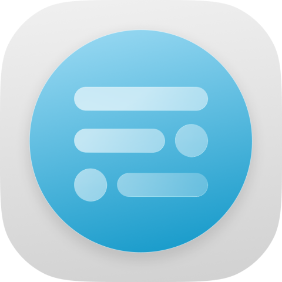

<p align="center">
  
</p>

<h1 align="center"><strong>HyperChanger Depth Wallpaper</strong></h1>

<p align="center">Give still photos depth and a sense of 3D space.</p>

<p align="center">
  <a href="README.md">简体中文</a> |
  <strong>English</strong> |
  <a href="README_ja.md">日本語</a>
</p>

<p align="center">
  <a href="https://github.com/ColdP/HyperChanger-Depth-Wallpaper">GitHub</a> |
  <a href="https://coldp.github.io/hyperchanger-updateinfo/">Model downloads</a> |
  <a href="https://github.com/ColdP/HyperChanger">Upstream project</a>
</p>

<p align="center">
  
  
  
</p>

## Overview

HyperChanger Depth Wallpaper is a standalone branch of [HyperChanger](https://github.com/ColdP/HyperChanger) focused on the Spatial Wallpaper Lab: on-device depth estimation turns a single photo into an image that can show depth and 3D motion as the phone tilts.

**Spatial effects are previewed inside the app only and are never written to the system wallpaper.**

## Branches

- `main`: includes the merged Spatial Wallpaper Lab and all features described below.
- `depth-wallpaper`: the original Spatial Wallpaper Lab feature branch, now merged into `main`.

Build the `main` branch to try spatial wallpapers.

## Features

### On-device depth estimation

- Depth Anything V2 Small (INT8)
- MiDaS Mobile (MiDaS v2.1 Small, 256×256)
- Depth Anything 3 Base (INT8)
- Models are downloaded on demand, verified with SHA-256, and run fully offline

### Subject mask and layered rendering

- Transparent artwork uses its Alpha channel as the initial foreground mask
- Subject matting is always enabled; select U2Netp, ISNet INT8 or BiRefNet Lite INT8 only from the Generate tab's Matting model dropdown
- Continuous masks follow image edges while retaining soft contours and separate small subjects; transparent images keep their original Alpha
- Subject and silhouette share one parallax transform so depth discontinuities do not tear edges
- A background plate plus soft-mask compositing keeps the subject moving as a whole instead of sliding pixel by pixel
- Weak background parallax and stronger subject parallax produce a limited, stable spatial change

### Preview and interaction

- Gyroscope-driven parallax with a subtle 3D tilt; drag to preview on devices without a sensor
- Pinch to zoom from 1× to 4× and drag to inspect details; double tap to reset zoom and viewpoint
- Render modes: original image / depth map / parallax only / depth of field / final composite
- Generation history: one card per project, tap a card to open the full-screen preview

### Resource downloads

Resources are hosted on GitHub Pages: <https://coldp.github.io/hyperchanger-updateinfo/>

| Resource | Size | Notes |
| --- | --- | --- |
| Depth Anything V2 Small | ~26 MB | INT8, stable detail and edges |
| MiDaS Mobile | ~63 MB | Faster, great for quick previews |
| Depth Anything 3 Base | ~99 MB | Best quality, noticeably slower |
| U2Netp Matting | ~4.4 MB | Optional lightweight matting model |
| ISNet INT8 | ~42.2 MB | 1024 resolution, balancing edges and speed |
| BiRefNet Lite INT8 | ~86.6 MB | Complex outlines and detail; higher memory use and generation time |

## Usage

1. Open the app directly into Spatial Wallpaper Lab.
2. Download depth and matting models from the Models tab; Depth Anything V2 Small and U2Netp are good defaults.
3. Return to Generate, choose an image and models, then tap "Generate spatial effect".
4. Open the full-screen preview and tilt the phone.
5. Use the History tab to view, preview or delete generated projects.

The bottom navigation contains Generate, History, Models and Settings. Generation and model downloads continue when switching tabs.

## Build

- JDK 17
- compileSdk 37, minSdk 35, targetSdk 37
- `arm64-v8a` only
- ONNX Runtime Android 1.31.0
- No NDK installation required

```bash
./gradlew :app:assembleDebug
```

Windows:

```powershell
.\gradlew.bat :app:assembleDebug
```

## Notes

- Hook implementations and registration entries unrelated to spatial wallpapers have been removed. Settings and its secondary pages remain unchanged; legacy module features no longer inject into the system.
- Depth and matting models run entirely on device; images are never uploaded.
- Generated results live in the app's private storage: original, depth map, mask, background plate and thumbnail.
- Deleting a downloaded model does not affect existing history; regenerate an old entry to obtain layered data.
- Mask edge and background-fill improvements apply to newly generated projects; regenerate existing entries to use them.
- Licensed under AGPL-3.0-or-later.

## Acknowledgements

- [Depth Anything V2](https://github.com/DepthAnything/Depth-Anything-V2) / [Depth Anything 3](https://github.com/ByteDance-Seed/depth-anything-3)
- [MiDaS](https://github.com/isl-org/MiDaS)
- [U2Net / rembg](https://github.com/danielgatis/rembg)
- [ONNX Runtime](https://github.com/microsoft/onnxruntime)
- [Miuix](https://github.com/compose-miuix-ui/miuix) and [backdrop](https://github.com/Kyant0/AndroidLiquidGlass)
- Upstream project [HyperChanger](https://github.com/ColdP/HyperChanger)
